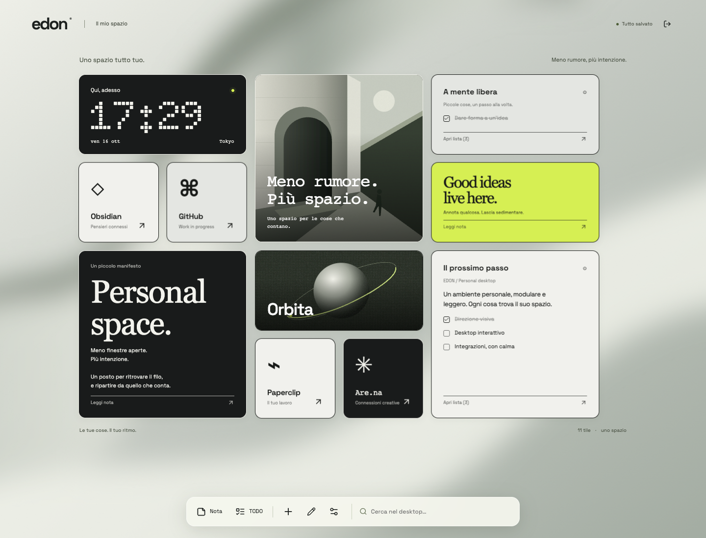

# EDON

**A private, local-first desktop made of tiles.** Notes, tasks, files, widgets, a Markdown vault and an agent API — all on your machine.

[](https://github.com/Duccioo/EDON/actions/workflows/ci.yml)
[](LICENSE)
[](https://nodejs.org/)



> **Status:** `0.1.0` — a complete, self-hosted preview. The application is usable and tested, but interfaces may still change before `1.0`.

## Why EDON

Most dashboards turn into another inbox. EDON is designed as a quiet personal canvas: a configurable grid, expressive tiles and no cloud account. Your data stays in local SQLite and in files you own.

- **Local-first:** SQLite, uploads and an optional Obsidian vault on disk.
- **Single-user by default:** password login, HTTP-only sessions, rate limits and a localhost binding.
- **Composable:** notes, tasks, links, images, files, clocks, folders, weather, timers, system metrics, AI quota widgets and a radio player.
- **Agent-ready:** scoped Bearer tokens, a REST API and a stateless MCP server.
- **Obsidian-aware:** browse, search, pin, edit and archive Markdown notes with two-way file synchronization.
- **Docker-friendly:** one container, one data volume, optional read/write vault mount.

## Highlights

- Dynamic grid from 2 to 12 columns and 2 to 128 rows. The fitted desktop starts at `900 × 600`; smaller screens switch to a scrollable layout and then a single column.
- Edit mode with drag, resize, compact, duplicate and per-tile inspection.
- Markdown notes and todos with inline editing, block/source modes, undo and live preview.
- Quick capture: write Markdown, convert `- [ ]` lines to todos, turn a lone URL into a link, or attach images and GIFs.
- Global appearance controls for spacing, shape, borders, opacity, glass and animated wallpapers.
- Folders with up to 24 child tiles, including vault-backed folders.
- Optional Obsidian vault integration with version checks, atomic writes, trash handling and symlink confinement.
- External agents through `Authorization: Bearer …`, REST or `/mcp`. Vault access is read-only for agents; with a Vault active, creating or editing notes/todos, linking Vault paths and mutating Vault files require a browser session.
- JSON export/import of the desktop plus documented on-disk backup.

## Quick start

Requirements: **Node.js 24 or newer** and npm.

```sh
npm ci
npm run dev
```

Open <http://127.0.0.1:5173> and create a password of at least 10 characters. The development server binds to localhost only.

For the production build:

```sh
npm run build
npm start
```

Open <http://127.0.0.1:3001>.

To load an optional `.env` file without editing package scripts:

```sh
node --env-file=.env --import tsx apps/server/src/index.ts
```

## Docker

Build and start from source:

```sh
docker compose up --build -d
```

Open <http://127.0.0.1:3001>. The `edon-data` volume keeps the database and uploads. Do not run `docker compose down -v` unless you want to delete them.

Published releases are available from GitHub Container Registry:

```sh
docker pull ghcr.io/duccioo/edon:latest
docker run --rm -p 127.0.0.1:3001:3001 -v edon-data:/app/data ghcr.io/duccioo/edon:latest
```

To mount an existing Obsidian vault:

```sh
OBSIDIAN_VAULT_HOST_PATH=/absolute/path/to/Vault \
  docker compose -f docker-compose.yml -f docs/docker-compose.obsidian.yml up --build -d
```

The container runs as `node` (UID 1000) and needs read, create, rename and delete permissions on the mounted vault. Mount only the intended directory and keep an independent backup.

For remote access, use HTTPS through a reverse proxy or a VPN. Set `COOKIE_SECURE=true` behind HTTPS and configure the first password before exposing the service. Never expose `data/` or the vault directory.

## Configuration

| Variable                  | Default     | Purpose                                                         |
| ------------------------- | ----------- | --------------------------------------------------------------- |
| `HOST`                    | `127.0.0.1` | HTTP bind address. Use `0.0.0.0` only inside a container/proxy. |
| `PORT`                    | `3001`      | HTTP port.                                                      |
| `DATA_DIR`                | `./data`    | SQLite database and uploaded files.                             |
| `COOKIE_SECURE`           | `false`     | Set `true` when the browser connects over HTTPS.                |
| `EDON_AGENT_TOKEN`        | empty       | Optional static Bearer token for agents.                        |
| `HERMES_URL`              | empty       | OpenAI-compatible Hermes endpoint.                              |
| `HERMES_API_KEY`          | empty       | Hermes API key; it stays server-side.                           |
| `HERMES_MODEL`            | empty       | Hermes model name.                                              |
| `OBSIDIAN_VAULT_PATH`     | empty       | Absolute path to the vault directory on the server.             |
| `OBSIDIAN_FOLDER`         | empty       | Default folder for new notes.                                   |
| `OBSIDIAN_ARCHIVE_FOLDER` | `.trash`    | Vault trash/archive folder.                                     |

See [`.env.example`](.env.example) for a ready-to-copy template.

## Obsidian

Configure the vault in **Settings → Integrations → Obsidian Vault**, or through `OBSIDIAN_VAULT_PATH`. EDON can browse and search `.md` files, pin notes and folders to the desktop, and synchronize linked notes and todos.

**Saving can rewrite, rename or trash Markdown files.** Use a copy of the vault for the first test and keep a separate backup. EDON refuses to overwrite notes it cannot represent losslessly, and it checks the file version before writing. See the [Obsidian guide](docs/obsidian.md) (Italian).

## Agents and MCP

Create a token in **Settings → Agents and tokens**, or set `EDON_AGENT_TOKEN`. The token grants access to tile/layout APIs and MCP. Vault reads are allowed. With a Vault active, note/todo creation and editing, Vault path linking, file deletion, telemetry, uploads and configuration require a browser session; agent tile operations never trigger a Vault sync.

```http
Authorization: Bearer edon_…
```

- REST API: [`docs/api.md`](docs/api.md)
- MCP tools and Hermes setup: [`docs/agents.md`](docs/agents.md)
- MCP endpoint: `POST /mcp`

## Data and backups

- `data/desktop.sqlite` contains the desktop, settings, password hash, sessions and hashed tokens.
- `data/uploads/` contains every uploaded file. The JSON export includes desktop metadata, not file bytes.
- A Vault is outside `data/` and requires a separate backup.

For a complete backup, stop EDON and copy the whole `data/` directory, including SQLite `-wal` and `-shm` files if present, then back up the vault separately. Restore before restarting. Unreferenced uploads are not garbage-collected automatically.

## Security

EDON is intended for a trusted single user or a small private deployment. It is not a multi-tenant platform.

- Use HTTPS or a VPN for remote access.
- Keep `data/`, vaults, backups and `.env` files private.
- The Hermes key saved through the UI is stored in plain text inside SQLite.
- Bearer tokens are scoped and stored as hashes; password changes revoke other browser sessions.
- Report vulnerabilities privately: see [SECURITY.md](SECURITY.md).

## Development

```sh
npm run build
npm test
npm run format:check
npx playwright install chromium   # once, unless CHROME_PATH is set
npm run test:e2e
```

The backend suite uses temporary directories. The browser suite starts an isolated server on port `4173`. CI runs on Node 24 with build, unit/integration tests, formatting, Playwright and a Docker image build.

Repository layout:

```text
apps/server     Fastify server, SQLite persistence, auth, vault and MCP
apps/web        React desktop and tile renderers
packages/shared Zod models, layout and capture logic
tests           Node and Playwright test suites
docs            Product, API, Obsidian and release documentation (Italian)
```

## Documentation

The product documentation is currently maintained in Italian:

- [Desktop guide](docs/desktop.md)
- [Obsidian integration](docs/obsidian.md)
- [HTTP API](docs/api.md)
- [Agents and MCP](docs/agents.md)
- [Verification record](docs/verification.md)
- [GitHub release guide](docs/github-release.md)
- [Release policy](docs/release.md)

## Contributing

Small, focused changes are welcome. Read [CONTRIBUTING.md](CONTRIBUTING.md), run the verification commands and never test destructive vault features against real notes. By contributing you agree that your work is released under the MIT License.

## License

Code and original assets are released under the [MIT License](LICENSE). Fonts and third-party dependencies retain their own licenses; asset provenance and exclusions are documented in [NOTICE](NOTICE).
